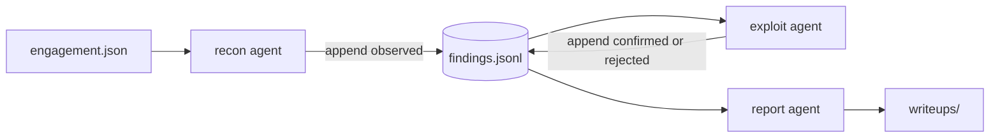

# Multi-agent assessments (vendor-neutral)

The MCP server is driven by **one client per session**. To run a larger
engagement across several agents — or several sessions of the same agent —
coordinate them through **files in a shared working directory**, not through any
host-specific subagent API. Every MCP-capable client can read and write files
and call the same governed tools, so this pattern behaves identically on Claude
Code, Codex, Cursor, Continue, Cline, Goose, and local models behind an MCP
host. See [`AGENTS.md`](../AGENTS.md) for the tool contract and
[`docs/AI_CLIENTS.md`](AI_CLIENTS.md) for per-client setup.

## Why files, not a host task API

- **Universality.** Coordination lives in the filesystem, which every client
  already has. Nothing depends on a proprietary fan-out primitive, so the same
  engagement is portable across clients.
- **Governance stays server-side.** Each client launches its own server instance
  (one VM per session by default), and every action passes that server's policy
  layer and lands in the shared host audit log. Give every agent identical
  `CYBERSEC_MCP_*` values so they share one scope, and mount the engagement
  directory with `CYBERSEC_SANDBOX_WORKSPACE` (guest path `/workspace`) so tools
  in the VM can see it.
- **Crash tolerance.** Append-only state survives a dead session. A replacement
  agent resumes from the files instead of from lost conversation history.

## Shared working directory

Pick one directory per engagement and treat it as the only source of truth:

```text
engagement/
  engagement.json   # coordination note: targets, rules of engagement (not enforced)
  findings.jsonl    # append-only; one finding per line, format in docs/FINDINGS.md
  state.json        # phase/status per role
  notes/            # freeform per-agent notes
  artifacts/        # captured output and evidence (sanitize before sharing)
```

`engagement.json` is a note that humans and agents read to stay on the same
page. **Nothing enforces it.** The server reads its policy from the environment
and the VM firewall reads its own scope file, so the note must match both:

```json
{
  "engagement": "acme-external-2026-08",
  "authorized_targets": ["10.10.0.0/24", "app.internal.example"],
  "launch_env_must_match": {
    "CYBERSEC_MCP_ALLOW_EXTERNAL": "0",
    "CYBERSEC_MCP_ALLOW_SCRIPTS": "0"
  },
  "notes": "Companion mode. Autonomous only on explicit written approval."
}
```

Enforcement comes from two places, set per agent session:

- `CYBERSEC_MCP_ALLOW_EXTERNAL` and `CYBERSEC_MCP_ALLOW_SCRIPTS` in the launch
  environment of every agent.
- `CYBERSEC_SANDBOX_SCOPE`, a scope file in the `name` / `allow` / `dns` format
  described in [`docs/SANDBOX.md`](SANDBOX.md#network-scope). The VM firewall
  rejects every destination outside it.

Findings use the schema in [`docs/FINDINGS.md`](FINDINGS.md) and are checked
with `python3 scripts/validate_findings.py engagement/findings.jsonl`. Each
finding is a single line appended to the file, so concurrent writers never
clobber each other. A recon agent records what a tool showed once as `observed`
(or what the target says as `claimed`), with its evidence and what is unchecked:

```json
{"id": "F-001", "title": "Login form reflects the next parameter", "kind": "observation", "status": "observed", "target": "app.internal.example", "evidence": [{"source": "run_tool", "tool": "curl", "command": "curl -s 'https://app.internal.example/login?next=%22x'", "captured_at": "2026-08-12T09:30:00Z", "locator": "response body, line 42", "excerpt": "value=\"\"x\""}], "uncertainty": "Not tested for XSS or open redirect."}
```

A status never changes in place. The agent that makes a second, independent
check appends a new line that reuses the target and adds the confirmation (a
new `id`, status `confirmed`, `derivation`, `confirmed_by`, evidence with a
hash). A lead that does not hold up is appended as `rejected` with the evidence
that ruled it out. Readers take the latest line per target and title
(see `docs/FINDINGS.md`).

## Roles and handoff

Give each agent one role and the same `engagement.json`. Handoff happens by
writing to `findings.jsonl` and `state.json`, not by passing messages.

| Role | Reads | Does | Writes |
| --- | --- | --- | --- |
| recon | `engagement.json` | `guided_assessment`, `run_tool`, `run_pipeline` | new `observed` / `claimed` findings |
| exploit | `findings.jsonl` (`observed` and `claimed`) | validate with `run_tool` / `run_script` | new `confirmed` / `rejected` lines |
| report | `findings.jsonl` (`confirmed`) | synthesize | a writeup under `writeups/` |



## Walkthrough

Two sessions against the same directory, in any two MCP clients:

1. **Recon session.** Start with `guided_assessment` (or `suggest_for_ctf` /
   `suggest_for_bounty`) to classify the target, then execute with
   `run_tool` / `run_pipeline`. Append each anomaly to `findings.jsonl` with
   `status: "observed"`, or `"claimed"` when the target only says so.
2. **Exploit session.** Read `findings.jsonl`, take every `observed` or
   `claimed` finding, and validate it with `run_tool` (or `run_script` only when
   programming logic is the smallest reliable path). Repeat the derivation from
   the original data, append a `confirmed` or `rejected` line and keep the proof
   in `artifacts/`. Another agent reading the same output is not a second check.
3. **Report.** Read the `confirmed` findings and write the mandatory technical
   writeup under `writeups/`. Sanitize evidence first — flag credentials by
   existence and access method, never by spreading the secret across outputs.

Because state is on disk, step 2 can start before step 1 finishes: the exploit
agent simply polls `findings.jsonl` for new `observed` lines.

## Governance and safety

- **Companion by default; autonomous only when asked.** Escalate a role to
  `guided_assessment(mode="autonomous")` only with explicit authorization
  recorded in `engagement.json`.
- **The boundary is the launch environment and `CYBERSEC_SANDBOX_SCOPE`, not
  `engagement.json`.** Agents also re-read the note and act only within
  `authorized_targets`. The server's `CYBERSEC_MCP_ALLOW_EXTERNAL=0` default is a
  preflight policy, not a network sandbox — keep the scope honest.
- **One audit trail.** All agents share the server's audit log, so the whole
  engagement is reconstructable from a single place.
- **Reusable helpers** go under `manual_scripts/`; **writeups** go under
  `writeups/`; findings stay in `engagement/findings.jsonl` next to the
  writeup. Both are shared across every agent in the run.

## Single-agent fallback

The pattern degrades cleanly to one session: the same directory makes a solo
run resumable after context compaction, since each phase reconstructs its state
from `engagement.json`, `findings.jsonl`, and `state.json` rather than from chat
history.

## Host accelerators (optional)

Some hosts add a native fan-out primitive — Claude Code's `Task` subagents, used
by the `zeroize-audit` and `semgrep` skills, is one example. Use it as an
accelerator *on top of* this pattern, but keep coordination in the shared files
so the engagement stays portable to clients that have no such primitive.
